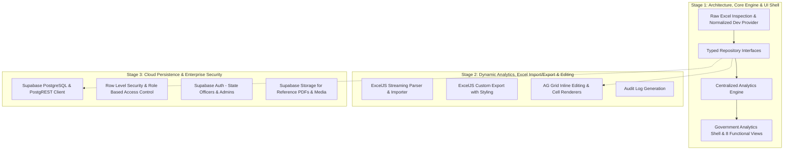

# MP Manifesto Analysis Dashboard - System Architecture

## 1. Architectural Vision & Objective

The **MP Manifesto Analysis Dashboard** is an enterprise-grade analytics, audit, and monitoring platform built to replace a legacy Microsoft Power BI dashboard for the Madhya Pradesh state government.

The platform provides:
- Executive KPI tracking across all 414 election manifesto promises.
- Interactive multi-dimensional analytics by Department, Category, Implementation Status, and Political Importance.
- High-performance editable spreadsheet view with sorting, filtering, and inline updates.
- Deep drilldown exploration from aggregate visualizations directly into underlying records.
- Deterministic, factual automated key insights generation.
- Full bilingual capability with flawless Devanagari (Hindi) and English typography.
- Future-proof data access layer enabling seamless transition from development memory provider to Supabase PostgreSQL with zero UI code refactoring.

---

## 2. Three-Stage Implementation Strategy



- **Stage 1 (Current Stage):** 
  - Complete inspection of `MP Manifesto Analysis.xlsx` and production of `docs/WORKBOOK_ANALYSIS.md`.
  - Implementation of typed data interfaces (`PromiseRepository`, `DepartmentRepository`, etc.).
  - Centralized in-memory development provider populated with 100% of real extracted records (414 promises, 45 departments, 10 categories).
  - Implementation of centralized analytics engine (`lib/analytics/`).
  - Implementation of the full responsive UI application shell across all 8 specified views.
  - Zero hardcoding of dashboard totals.
- **Stage 2:**
  - Full client-side & server-side Excel ingestion with Zod validation.
  - Round-trip Excel export using ExcelJS.
  - Inline AG Grid editing workflow with optimistic updates and change tracking.
  - Audit logging system recording who updated what and when.
- **Stage 3:**
  - Supabase database schema, foreign key constraints, indexes, and migrations.
  - Supabase client integration swapping Dev Repository for Supabase Repository.
  - Role-based authentication (Admin vs Department Officer vs Viewer).
  - Storage bucket setup for official documents and news clipping attachments.

---

## 3. Layered Component Architecture

```
┌─────────────────────────────────────────────────────────────┐
│                    Presentation Layer                       │
│  App Router Pages (app/(dashboard)/*, app/admin/*)          │
│  UI Component Library (components/ui/*, components/layout/*) │
│  Domain Components (components/dashboard/*, charts/*)       │
└──────────────────────────────┬──────────────────────────────┘
                               │
┌──────────────────────────────▼──────────────────────────────┐
│                    State & Filter Layer                     │
│  DashboardFilterContext: Shared cross-page filter state     │
│  useDashboardFilters: Department, Category, Status, Search  │
└──────────────────────────────┬──────────────────────────────┘
                               │
┌──────────────────────────────▼──────────────────────────────┐
│                  Analytics Calculation Layer                │
│  lib/analytics/metrics.ts: Deterministic aggregation engine │
│  - Total count, status counts, completion % formula         │
│  - Department rollups, category rollups, pending rankings   │
└──────────────────────────────┬──────────────────────────────┘
                               │
┌──────────────────────────────▼──────────────────────────────┐
│                   Data Access Layer (DAL)                   │
│  lib/repositories/interfaces.ts                             │
│  - PromiseRepository                                        │
│  - DepartmentRepository                                     │
│  - CategoryRepository                                       │
│  - AnalyticsRepository                                      │
│  - AuditRepository                                          │
└──────────────────────────────┬──────────────────────────────┘
                               │
         ┌─────────────────────┴─────────────────────┐
         ▼                                           ▼
┌──────────────────────────────┐   ┌──────────────────────────────┐
│ Stage 1 & 2: Dev Provider    │   │ Stage 3: Supabase Repository │
│ lib/repositories/dev/        │   │ lib/repositories/supabase/   │
│ - In-memory typed store      │   │ - Supabase PostgreSQL client │
│ - 414 extracted promises     │   │ - Row Level Security (RLS)   │
│ - Search, filter, CRUD       │   │ - Realtime subscriptions     │
└──────────────────────────────┘   └──────────────────────────────┘
```

---

## 4. Typography & Hindi Devanagari Rendering Strategy

Government dashboards in India frequently suffer from font clipping, misaligned matras (vowel signs), or conjunct character corruption.

To guarantee crisp, readable Hindi text rendering:
1. **Font Stack:**
   - Primary: `Noto Sans Devanagari` via `next/font/google`.
   - Fallback system stack: `'Noto Sans Devanagari', 'Mangal', 'Nirmala UI', system-ui, sans-serif`.
   - Secondary Latin font: `Inter` or `Geist` for numbers, dates, and English identifiers.
2. **CSS Configuration:**
   ```css
   .font-devanagari {
     font-family: var(--font-noto-sans-devanagari), 'Mangal', 'Nirmala UI', sans-serif;
     text-rendering: optimizeLegibility;
     -webkit-font-smoothing: antialiased;
     line-height: 1.6; /* Ample line height prevents Hindi vowel marks from clipping */
   }
   ```
3. **Data Integrity:**
   - Raw Excel values in UTF-8 are preserved verbatim (`statusRaw`, `title`, `description`).
   - Canonical status keys (`COMPLETED`, `IN_PROGRESS`, etc.) are used for programmatic comparisons and styling, while Hindi labels are dynamically formatted through a centralized display formatter.

---

## 5. Directory Structure

```
mp-manifesto/
├── app/
│   ├── (dashboard)/
│   │   ├── layout.tsx             # Shared dashboard shell (sidebar + header + filter bar)
│   │   ├── page.tsx               # 1. Overview Dashboard
│   │   ├── promises/
│   │   │   ├── page.tsx           # 2. All Promises table
│   │   │   └── [id]/page.tsx      # 7. Promise Details view
│   │   ├── analysis/page.tsx      # 3. In-depth Analysis & charts
│   │   ├── departments/page.tsx   # 4. Department Performance view
│   │   ├── categories/page.tsx    # 5. Category Breakdown view
│   │   └── insights/page.tsx      # 6. Key Data-Driven Insights
│   ├── admin/page.tsx             # 8. Data Management & Excel Tools
│   ├── api/
│   │   ├── promises/route.ts      # REST API for Promise records
│   │   ├── analytics/route.ts     # Aggregated analytics API
│   │   └── export/route.ts        # Excel export generation
│   ├── globals.css                # Tailwind v4 theme & Hindi typography
│   └── layout.tsx                 # Root layout with Noto Sans Devanagari font
├── components/
│   ├── layout/
│   │   ├── Sidebar.tsx            # Collapsible government sidebar
│   │   ├── Header.tsx             # Top navigation & breadcrumbs
│   │   ├── FilterBar.tsx          # Shared multi-select filter bar
│   │   └── DevBanner.tsx          # Transparent Development Mode indicator
│   ├── dashboard/
│   │   ├── KpiCard.tsx            # Metric cards with trend & progress
│   │   └── StatusBadge.tsx        # Canonical Hindi status badges
│   ├── charts/
│   │   ├── EChartWrapper.tsx      # Client-side Apache ECharts wrapper
│   │   ├── StatusDistribution.tsx # Donut chart of status
│   │   ├── DepartmentBarChart.tsx # Horizontal bar comparison
│   │   └── CategoryCompletion.tsx # Category status breakdown chart
│   ├── tables/
│   │   └── PromiseTable.tsx       # Spreadsheet table with search & sort
│   └── ui/                        # Reusable buttons, dialogs, cards, badges
├── lib/
│   ├── analytics/
│   │   ├── metrics.ts             # Deterministic KPI & aggregation rules
│   │   └── insights.ts            # Data-driven key insights engine
│   ├── data/
│   │   └── manifesto_data.json    # 414 extracted records from workbook
│   ├── repositories/
│   │   ├── interfaces.ts          # Typed repository interfaces
│   │   ├── dev/
│   │   │   └── dev-repository.ts  # Development in-memory provider
│   │   └── index.ts               # Repository factory / resolver
│   ├── context/
│   │   └── FilterContext.tsx      # Shared filter provider
│   └── excel/
│       ├── parser.ts              # ExcelJS streaming importer
│       └── exporter.ts            # ExcelJS styled exporter
├── types/
│   ├── promise.ts                 # Promise, Status, Importance types
│   ├── filter.ts                  # Filter options & state types
│   └── analytics.ts               # Metric rollup interfaces
├── docs/
│   ├── WORKBOOK_ANALYSIS.md       # Full workbook inspection report
│   ├── ARCHITECTURE.md            # System architecture document
│   └── DATA_MODEL.md              # Database schema & entity models
├── supabase/
│   └── migrations/
│       └── 001_initial_schema.sql # Production PostgreSQL migration
└── tests/
    └── analytics.test.ts          # Unit tests for KPI calculations
```
